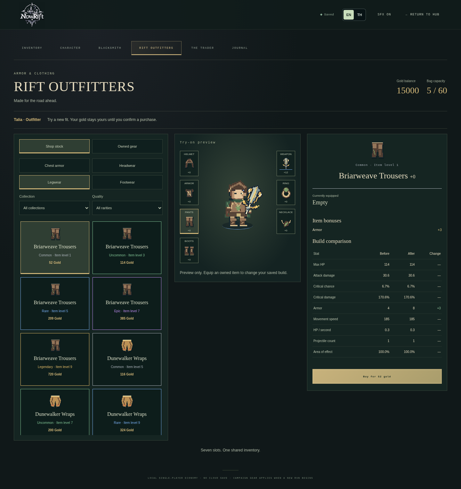
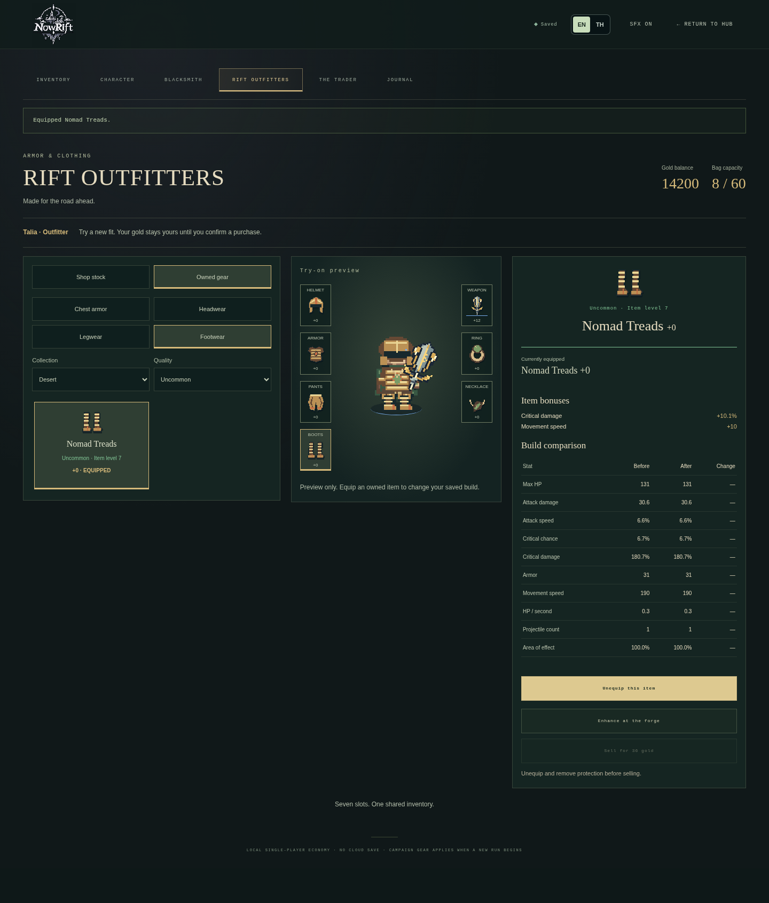
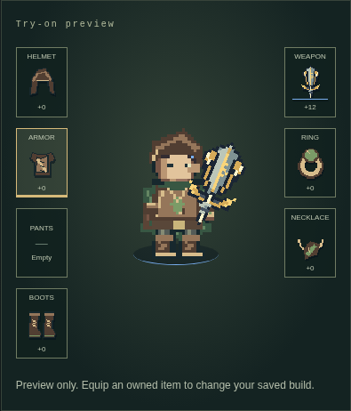
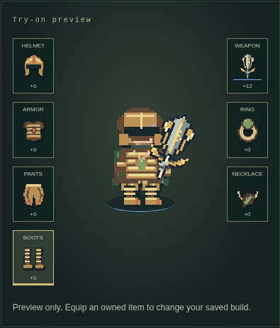
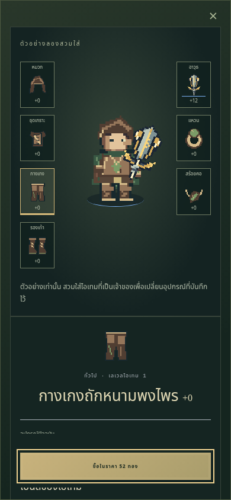
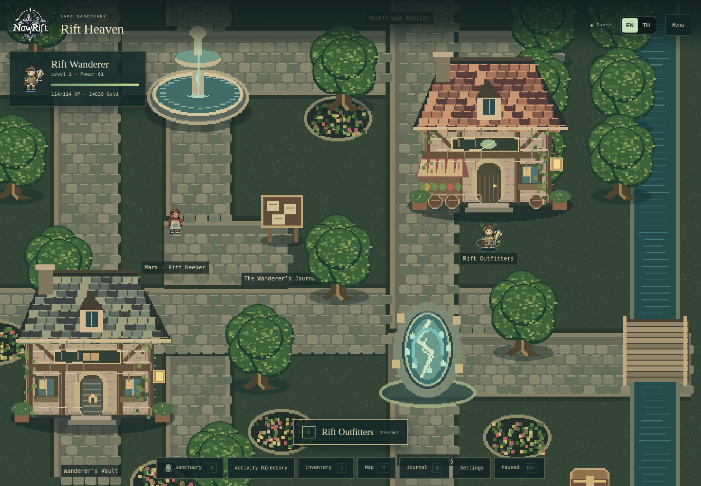

# Rift Outfitters & Equipment

Visit **Rift Outfitters** at the existing market entrance in Rift Heaven, use the
Activity Directory or map to find it, and interact with **E** or touch. The merchant
opens inside the existing RPG screen. Browse chest armor, headwear, legwear or
footwear; select a collection and rarity; inspect the layered try-on and real build
comparison; confirm the purchase; then **Inspect owned copy → Equip this item**.
Owned gear supports unequip, eligible sale and **Enhance at the forge**, which opens
the existing blacksmith with that exact instance selected.

## Audit and integration

The implementation starts from `main` at `5efcc88`, including the merged weapon
evolution system. The audit covered RPG models/content/items/actions/inventory,
validation and persistence, stats/enhancement, appearance and asset resolution,
CharacterRig, CharacterPreview, RpgScreen, HavenGame and SanctuaryPanel.

The market landmark retains `id: market`, its merchant kind, entrance, collision
and world interaction. Its name and directory entry now identify Rift Outfitters.
HavenGame opens the new `outfitters` tab; the general trader and crafting tab retain
their original eight offers. The merchant has local selection/filter state only.
All gold, ownership, materials, equipment, revisions, receipts and capacity remain
in the existing per-character save and command pipeline. No database or account is
required, and no additional economy or inventory was introduced.

## Seven slots and save compatibility

`Slot`/`SLOTS` now include independent `pants`. `LEGACY_SLOTS` preserves the exact
old six-slot order for original IDs, icon indexing, starter grants and historical
appearance snapshots. All current equipment/stat/inventory consumers use seven
slots, including the existing inventory category filter and character paperdoll.

RPG schema **1 → 2** is deliberate and strict:

1. Validate the full legacy schema, including exactly the original six equipped
   keys, valid instance references, affixes, enhancement, receipts and capacity.
2. Clone it, set `schema: 2` and add `equipped.pants: null`.
3. Validate and persist through the existing repository load path. Already current
   state is returned unchanged. Damaged data remains rejected and preserved by the
   existing recovery flow; it is never repaired by dropping items or granting gear.

Fresh characters still receive the original six starter items, once. No pants are
granted on creation or migration. The new neutral base trousers are cosmetic.
Equipment instance IDs, rarity, affixes, enhancement/pity, gold/materials, XP,
receipts, quests, checkpoints and all other progression remain intact. Each local
character migrates independently. The outer save and backup bundle schemas do not
change; backup checksums are verified against the original payload before nested
migration. The existing outfit achievement keeps its ID, target of six items,
progress and rewards; its description now says “Equip six items.”

The committed golden six-slot fixture was generated with the pre-change appearance
resolver. It contains mixed themed enhanced gear, protected gear, currency,
materials, rewards and a real frozen run checkpoint. Tests compare the entire
migrated value against the original plus only the schema and null-slot changes,
then reload it repeatedly through the repository.

## Catalog, economy and stats

The existing twelve biome armor/helmet/boots definitions are reused. Four stable
new IDs complete the collections:

| Collection | Pants ID         | Name                 |
| ---------- | ---------------- | -------------------- |
| Forest     | `forest-pants`   | Briarweave Trousers  |
| Desert     | `desert-pants`   | Dunewalker Wraps     |
| Frozen     | `frozen-pants`   | Frostguard Legplates |
| Infernal   | `infernal-pants` | Cinderweave Greaves  |

`OUTFITTER_OFFERS` contains **80** offers: four collections × four categories ×
five existing rarities. They are included in authoritative `SHOP`, now **87**
offers in total. The original uncommon level-3 forest vest offer remains the same
object, ID and 120-gold price and is shared with the general trader.

Other offers use collection index `w` and rarity index `r`:

```text
level = 1 + 4w + 2r
price = ceil((36 + 16 × level) × existing rarity cost)
```

Forest common gear starts at **52 gold**. Collection progression requires the
preceding world's Normal guardian clear; Rare/Epic/Legendary additionally require
the Forest/Desert/Frozen Normal guardian respectively. The stronger of these gates
applies. Eligibility reads actual `clears`, never XP or a display-only unlock.
The UI names the required guardian and shares `purchaseEligibility()` with the
atomic buy command. It checks integer quantity 1–99, gate, actual bag capacity and
wallet. Existing invalid-offer checks, revisions, unique instance IDs and receipt
idempotency remain authoritative. Replayed commands cannot charge twice.

Shop previews use `shopEquipment()` and therefore show the same fixed rolls as the
purchased item. `previewEquipment()` creates a validated display-only clone and
replaces only the candidate's slot. Both comparison totals call `calculateStats()`
and respect caps. Item bonuses call `itemStats()`. Pants prioritize armor using the
existing scaling, affixes and enhancement rules; armor retains max-HP/armor,
helmets armor, and boots speed. No unsupported bonus or new stat was added.
The original sale quote and equipped/locked/favorite protections remain in force.
Pants enhancement uses the same wood/stone costs and success/downgrade/pity rules
as other cloth/armor slots. No chance, cap or weapon milestone rule changed.

## Appearance and frozen runs

New live appearances and newly frozen runs use **appearance schema 2**. Pants
resolve their own item/rarity layer, or `pants-base` when empty. Boots resolve the
new biome-specific footwear layer. Chest armor continues to determine torso and
its related glove layer; headwear and jewelry retain their own layers. All three
archetypes retain skin, face, hair, outfit palette, held weapons and synchronized
four-direction animations. The existing rig, anchors, layer order and hitboxes
remain authoritative.

**Appearance schema 1 stays valid and immutable.** Its canonical construction,
six-slot fingerprint, chest-derived pants and original boot asset paths remain
available. A historical run/checkpoint restores its original frozen stats,
appearance and evolved weapon even after the town save migrates or equips new
gear. No snapshot is rebuilt from current town equipment. Story Mode, Free Mode
and hub expeditions still freeze new runs through the existing shared stat and
appearance functions.

## Original art and generation

- `public/assets/items/outfitters.png`: **128 × 128**, sixteen 32px icons, columns
  armor/headwear/pants/boots, rows Forest/Desert/Frozen/Infernal. Registered as
  `outfitters-items` with adjacent JSON metadata.
- `art/outfitters/*.svg`: sixteen original, integer-grid, editable CC0 sources.
  Forest leather/bark, Desert bronze/wraps, Frozen steel/facets and Infernal
  volcanic/crimson shapes have distinct silhouettes and texture clusters.
- **75** new modular atlases across Wanderer, Sentinel and Strider: neutral pants,
  four biome legwear families and four footwear families with three existing
  rarity shapes each. Each atlas is **1248 × 192**, 26 columns × four directions,
  **104 48px frames**, pivot **(24,36)**, binary alpha, nearest-neighbor art.
- The first **44** original item-atlas cells are pixel-identical. New pants use
  only formerly unused cells **44–47**. No material, weapon, consumable or saved
  icon index moves. ItemIcon uses the new dedicated sixteen-icon atlas for apparel.
- Old character layers stay intact for historical snapshots. The existing selected
  appearance loader and lazy wardrobe cache strategy load new layers on demand.
  The service-worker cache advances to `v18-outfitters` and warms the small icon
  atlas. The generated index now covers 431 PNGs, approximately 2 MB total.

```sh
npm run assets:outfitters
python3 scripts/generate-outfitters.py --check
npm run design:outfitters
npm run assets:check
```

The full `npm run assets:generate` pipeline also invokes the new art generator.
Pillow is required only for regeneration. Browser, build and asset tests require
no Python dependency. Never edit `asset-index.ts` manually.

## Design, localization and responsive behavior

Capability discovery found **no callable Figma MCP tools**. No Figma design
context/variables were read; editable frames, components/variants, export,
screenshots and file updates were unavailable. No native Figma file or URL was
created. The permitted fallback is [NowRift — Rift Outfitters & Equipment](design/outfitters.html),
five editable local HTML/SVG boards generated from production offers, numeric
stat previews, eligibility and modular art:

- A: desktop catalog / try-on / purchase and a 390px mobile layout toggle.
- B: seven-slot character paperdoll and selected/empty/owned variants.
- C: current versus candidate, real before/after values, signed changes.
- D: dialogue, selection, confirmation, success, insufficient gold, full bag,
  equip and sale states.
- E: all sixteen icons at enlarged/native scale, material notes and design tokens.

Serve the repository root with `python3 -m http.server 3200` and open
`http://localhost:3200/docs/design/outfitters.html` to review the boards and sources.
They document the shipped layout; they are not a separate game or new game route.

Desktop uses three flexible columns. At 900px and below, item selection opens the
existing accessible Modal as a full-height detail/try-on sheet with close/Escape,
focus trapping, scrolling and sticky purchase/equipment actions. Buttons are at
least 44px high. Catalog filters, rarities, names, eligibility, comparisons,
confirmations and all new equipment strings support English and Thai. Stat colors
also have signed numeric values or a neutral em dash.

## Validation and screenshots

The instrumented production build passed all **126 Playwright scenarios**, including
all ten new merchant scenarios. Typecheck, ESLint, format checking, asset validation
and deterministic art checking passed. The **459 unit/integration tests** passed. A normal production rebuild and **10
additional production-browser scenarios** also passed, including a check that
instrumentation globals are absent. Both ordinary and instrumented builds passed
`npm run build`; the workspace is left on the ordinary production build.
The unit suite covers migration, persistence, all 80 offers,
idempotency, funds/capacity/gates, invalid data, equip/remove/replace stats,
protected selling, all classes/themes/rarities, enhancement, immutable modes and
checkpoints, localization and decoded PNG dimensions/alpha/silhouettes/registry.
Browser scenarios exercise the actual merchant commands, all categories,
comparisons, forge/sell/reload, mobile Thai, historical migration, all three
classes and the retained live hub rig with an evolved weapon.

Screenshots use seeded local test characters. The before/after views show real
purchases and equips of all four Desert categories, with the same +12 weapon.




| Before purchases                                   | After equipping Desert clothing                  |
| -------------------------------------------------- | ------------------------------------------------ |
|  |  |




