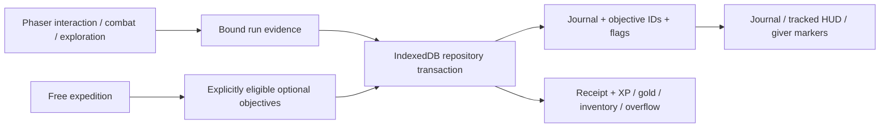

# The Shattered Rift — campaign and quest expansion

## Implemented scope

The playable campaign now has four connected chapters, forty objective-based Story missions,
and 120 authored bilingual quests: 40 Main, 40 Side, 24 Guild contracts, and 16 NPC-chain entries.
The original stage IDs 1–5, major guardians at Stage 5, character, equipment, city, and
resource expeditions are retained. Each chapter adds stages 6–10 and a three-phase finale.

This continuation started from the repaired city implementation at `cd51e74`.
The current `main` changes through `0c97e82` (PR #24's backpack expansion and bulk actions)
were integrated during development. The draft targets `main`.

Figma capability discovery returned no callable Figma tools. The editable
[mission design board](design/shattered-rift-missions.svg) is generated locally from the
production definitions; no Figma output is claimed.

## Audit and preserved systems

The starting campaign had twenty timer/boss stages and no reusable narrative quest runtime.
The only hub narrative quest was the arrival/extraction prologue. Daily objectives and
achievements already used real metrics and remain independent.

The existing nine-district Rift Haven, Town Map, stable waypoint IDs, landing validation,
writer ownership, arrival epochs, camera, collision, character appearance, weapon evolution,
shops, crafting, upgrades, wardrobe, training, sound, and day/night presentation remain in use.
See the [city specification](haven-city.md) for its layout and original art pipeline.
The renderer and seeded biome maps remain in place.

## Mission gameplay

`story/content.ts` and the chapter files author actual targets, positions, routes, dialogue,
and ordered objectives. The runtime supports conversation, exploration, elimination,
collection, rescue, defense, escort, ordered mechanisms, weapon-driven destruction,
mini-bosses, timed encounter survival, and multi-phase guardian fights.

- Interaction requires physical range and the current objective. Repeated pickups and used
  mechanisms cannot award progress again; a wrong rune gives feedback without completing it.
- Defense advances beside a living ally. Raiders attack the ally; losing the ally fails the
  mission. Escort movement requires accompaniment and follows a collision-aware grid route.
- Destructible machinery has real combat health. Destroying it advances sabotage without
  producing enemy XP, loot, or kill statistics.
- Finales switch attack behavior at two-thirds and one-third health. Realm attacks and a
  final cross volley use the existing projectile/hazard simulation.
- Story completion requires the full ordered mission receipt. Non-boss missions finish when
  their objectives finish. Free expeditions keep their gather/combat/extraction rules.
- Briefings freeze simulation. NPC dialogue pauses play. Objective HUD, progress, companion
  health, directional landmarks, contextual E/touch actions, and notifications use live state.

The lifecycle proceeds through scene start, briefing, active/completed/next objectives,
final encounter, mission completion, repository reward settlement, and return to Haven.
Completed objective boundaries checkpoint immediately, before the periodic ten-second
combat autosave. Unlock notifications compare the actual before/after campaign access,
including new difficulties and grandfathered access, rather than assuming another stage opened.
Story runs auto-accept an available associated Main quest. Main quest rewards are claimed
at the actual giver after the mission; return dialogue acknowledgement grants no reward.

The Forest Stage 1 vertical slice was completed and browser-tested before the remaining
missions were authored. Reusable escort, defense, puzzle, destruction, and boss primitives
were tested before content depending on them was added.

## Quest authority and rewards

The repository binds each fresh run to a stage, seed, difficulty, activity, mode, and mission
version. Checkpoints and results must match this identity. Gameplay facts are deduplicated
against saved run evidence. Caller-supplied Story labels cannot turn a Free run into Story.

Main quests accept Story evidence. Optional quests declare their allowed modes; the journal
shows their mode eligibility. Combat, scripted mission interactions, hub visits, actual
inventory gains, daily material gifts, and delivery consumption supply the relevant events.
Only a verified Story settlement can emit `CompleteStage`.

Quest giver commands validate the Haven session, arrival epoch, safe coordinates, and range.
Delivery removes actual unprotected inventory. Claims grant real gold, XP, registry items,
equipment, and overflow parcels inside the same IndexedDB transaction as their permanent
receipt and completion state. Claim retries and concurrent claims do not pay twice.
New equipment rewards stay in the bag or overflow; equipment is never silently replaced.

The journal has Main / Side / Guild / Completed views, NPC-chain labels, current requirements,
objective counts, real rewards, tracking, mode badges, and bilingual dialogue. Q and touch
controls open it in gameplay and Haven. Markers show ! / ? / active state, combining the
new journal and the retained supply-route prologue. Locked entries explain their prerequisites.

## Save compatibility

- Outer character/profile schema 2, world schema 2 / layout revision 3, and checkpoint
  schema 1 remain valid. The optional versioned journal is added without replacing progress.
- Existing completed stages keep their exact clear records. Their new Main entries are
  recorded as legacy-completed and paid, so migration grants no retroactive rewards.
- A one-time access migration preserves previously earned world entry, Hard, and Nightmare
  access from the original five-stage campaign. New characters require all ten stages for
  the new chapter/difficulty gates. Cleared stages remain replayable.
- Existing frozen checkpoints retain their timer-based 1–5 mission model, equipment,
  random stream, actors, and counters. Fresh Story launches use the objective runtime.
- The original five-stage forest achievement and existing guardian equipment gates retain
  their earned meaning. New map counts and completion percentages derive from the registry.
- Purchased backpack capacity and smart bulk actions from PR #24 are retained. Save
  validation now checks the purchased capacity, allowing real quest rewards and reloads
  with more than sixty occupied bag slots.
- The legacy arrival quest and its extraction/claim receipt remain functional and visible
  in the supply-route section. Existing daily claims, backups, and ownership guards remain.

## Content and asset inventory

The full machine-readable inventory is [shattered-rift-content.json](shattered-rift-content.json).
It contains mission IDs/objective types and every quest's category, giver, mode, prerequisites,
and actual rewards. Regenerate it and the design board with `npm run design:story`.

[shattered-rift-assets.json](shattered-rift-assets.json) lists reused registry paths,
dimensions, frame counts, sizes, and checksums. Story actors use the original 48px resident
atlas with stable cast variants and directional movement. Items use the registered 32px atlas;
mechanisms and sabotage targets reuse original props. Quest glyphs are original editable
12×18 pixel definitions in `haven-city.ts`. No texture is stretched into a new building or boss.

Remaining art extensions: dedicated sprites/portraits for the four chapter finales and named
cast, distinct mechanism/siphon/prism/anchor skins, and voiced cinematic/audio sequences.
Current encounters use existing realm guardian art and accessible text dialogue.
Long-form balance playtests with naturally earned loadouts remain a follow-up; automated
mission fixtures accelerate travel and combat while exercising production objective triggers.

## Stage specification

| Stage         | Name                   | Story quest                    | Ordered gameplay                                           |
| ------------- | ---------------------- | ------------------------------ | ---------------------------------------------------------- |
| `forest-1`    | Mossbound Trail        | The Heartwood's First Wound    | TalkToNPC → DiscoverArea → DefeatEnemy ×4 → CollectItem ×3 |
| `forest-2`    | Ruined Crossing        | A Voice Beneath the Bridge     | DiscoverArea → DefeatEnemy ×3 → RescueNPC                  |
| `forest-3`    | Thornwatch             | Keep the Signal Alive          | TalkToNPC → DefendLocation ×22 → DiscoverArea              |
| `forest-4`    | The Deepwood           | The Language of Roots          | DiscoverArea → ActivateMechanism ×3 → CollectItem          |
| `forest-5`    | Heart of the Grove     | The Guardian's Burden          | DiscoverArea → DefeatBoss                                  |
| `forest-6`    | Rootglass Aqueduct     | Water from Another Sky         | TalkToNPC → DiscoverArea → CollectItem ×2                  |
| `forest-7`    | The Black Sap Works    | Cut the Poison's Supply        | DefeatEnemy ×5 → DestroyObject ×3 → DiscoverArea           |
| `forest-8`    | Lantern Refuge         | No One Left in the Dark        | RescueNPC → EscortNPC                                      |
| `forest-9`    | Briar Captain's Hollow | The Keeper of Stolen Names     | DiscoverArea → DefeatEnemy → CollectItem                   |
| `forest-10`   | The Heartwood Conduit  | A Heart That Can Let Go        | ActivateMechanism ×3 → DefeatBoss → DiscoverArea           |
| `desert-1`    | Dune Approach          | The City the Sand Remembers    | TalkToNPC → DiscoverArea → CollectItem ×3                  |
| `desert-2`    | Buried Causeway        | A Caravan Worth More Than Gold | DefeatEnemy ×5 → EscortNPC                                 |
| `desert-3`    | Sunken Citadel         | Three Hours of Sunlight        | DiscoverArea → ActivateMechanism ×3 → CollectItem          |
| `desert-4`    | Sands of Trial         | Let the Record Speak           | DefendLocation ×24 → DefeatEnemy ×3 → DiscoverArea         |
| `desert-5`    | Throne of the Sun      | A Throne Cannot Drink          | DiscoverArea → DefeatBoss                                  |
| `desert-6`    | The Buried Archive     | The Pages They Removed         | TalkToNPC → DiscoverArea → CollectItem ×2                  |
| `desert-7`    | Sunforge Reservoir     | Open the People's Well         | DestroyObject ×3 → DefendLocation ×22                      |
| `desert-8`    | Caravan of Names       | Carry the Living Record        | RescueNPC → EscortNPC                                      |
| `desert-9`    | The Gilded Sentinel    | An Order Without a King        | DiscoverArea → DefeatEnemy → CollectItem                   |
| `desert-10`   | The Last Meridian      | Share the Dawn                 | ActivateMechanism ×3 → DefeatBoss → DiscoverArea           |
| `frozen-1`    | Snowfall Reach         | The Voice Inside the Ice       | DiscoverArea → RescueNPC → CollectItem ×2                  |
| `frozen-2`    | Fractured Lake         | Across the Years Between Us    | DefeatEnemy ×4 → EscortNPC                                 |
| `frozen-3`    | Icebound Hall          | Consent of the Sleeping        | ActivateMechanism ×3 → RescueNPC                           |
| `frozen-4`    | Blizzard Pass          | A Signal Through the White     | DefendLocation ×24 → DefeatEnemy ×4                        |
| `frozen-5`    | The Silent Warden      | The Oath Beneath the Frost     | DiscoverArea → DefeatBoss                                  |
| `frozen-6`    | Hall of Witnesses      | Who Held the Door              | TalkToNPC → DiscoverArea → CollectItem ×2                  |
| `frozen-7`    | The Broken Lens        | Stop the False Winter          | DestroyObject ×3 → DefeatEnemy ×3                          |
| `frozen-8`    | Pilgrim's Thaw         | The Slow Road Home             | RescueNPC → EscortNPC                                      |
| `frozen-9`    | The White Marshal      | An Oath Turned Inward          | DefeatEnemy → DiscoverArea → CollectItem                   |
| `frozen-10`   | The Unsealed Truth     | Let the Witnesses Walk         | DefendLocation ×18 → DefeatBoss → ActivateMechanism ×3     |
| `infernal-1`  | Ashen Gate             | A Workshop Still Warm          | TalkToNPC → DiscoverArea → CollectItem ×2                  |
| `infernal-2`  | Obsidian Crossing      | The Last Shift                 | DefeatEnemy ×5 → RescueNPC                                 |
| `infernal-3`  | Burning Sanctum        | Hands Steadier Than Fire       | DefendLocation ×24 → CollectItem                           |
| `infernal-4`  | Ember Crucible         | Teach the Furnace to Breathe   | ActivateMechanism ×3 → DestroyObject ×2                    |
| `infernal-5`  | Sovereign’s Fall       | The Crown Above the Engine     | DiscoverArea → DefeatBoss                                  |
| `infernal-6`  | The First Workshop     | The Name Under the Crown       | TalkToNPC → DiscoverArea → CollectItem ×2                  |
| `infernal-7`  | Chains of the Engine   | No More Single Shoulders       | DestroyObject ×3 → SurviveEncounter ×18                    |
| `infernal-8`  | The Way Back           | Leave a Door Open              | EscortNPC → DefendLocation ×18                             |
| `infernal-9`  | The Ashbound Architect | The Last Wrong Answer          | DefeatEnemy → TalkToNPC                                    |
| `infernal-10` | The First Fracture     | A Rift Held by Everyone        | ActivateMechanism ×3 → DefeatBoss → DiscoverArea           |

## Visual evidence

Captured from the final instrumented browser run; no illustration or mockup is used here.
The boss captures show the existing guardian artwork during the new third combat phase.

| View                      | Desktop                                                 | Mobile                                                 |
| ------------------------- | ------------------------------------------------------- | ------------------------------------------------------ |
| Forest objective gameplay | [Screenshot](evidence/story/forest-mission-desktop.png) | [Screenshot](evidence/story/forest-mission-mobile.png) |
| Quest journal             | [English](evidence/story/quest-journal-desktop.png)     | [Thai](evidence/story/quest-journal-thai-mobile.png)   |

Chapter finales: [Forest](evidence/story/forest-10-boss.png),
[Desert](evidence/story/desert-10-boss.png), [Frozen](evidence/story/frozen-10-boss.png),
[Infernal](evidence/story/infernal-10-boss.png).

## Validation

- The final instrumented build passed asset validation, TypeScript, production compilation,
  and 638 unit / integration tests in 32 files. Formatting and lint passed.
- All forty missions were exercised on Normal, Hard, and Nightmare through production
  triggers. Checkpoints restore each objective; authored landmarks and escort routes were
  checked across twelve seeds, with spawn-to-object routes checked on representative seeds.
- Tests cover source forgery, locked travel, safe recovery, legacy clear/access migration,
  item protection/consumption, concurrent claims, overflow, equipped-item preservation,
  expanded backpacks, daily material gifts, and live journal projection.
- The complete instrumented browser suite at `738e57a` passed **140 tests**, with the one
  production-only Town Map test skipped (16.8 minutes, Chromium 156). This includes every
  Normal mission, all Stage 5/10 Hard and Nightmare guardians, first-clear persistence,
  immediate objective checkpoints, dialogue, deliveries, tracking, giver markers, desktop /
  Thai touch layouts, inventory expansion, and the existing city/navigation regressions.
- Browser fixtures accelerate movement and inject combat actors / projectiles; they do not
  directly complete objectives or fabricate mission receipts. Separate runtime tests cover
  vulnerable defense/escort failure, puzzles, destruction, and real boss phase transitions.
- The subsequent history-label localization change passed 30 focused quest / localization
  tests. At final source commit `c833dc5`, both instrumented and uninstrumented builds
  passed all 638 tests, asset checks and TypeScript. The instrumented Forest mission /
  immediate-checkpoint follow-up passed 2 browser tests (22.0 seconds).
- The final uninstrumented production Town Map test passed (12.9 seconds), including
  safe travel, reload, preserved character and unavailable test globals. Bundle inspection
  found zero test-hook / mission-driver signature matches across 18 browser chunks.
  `next.config.ts` supplies an explicit default-off build flag so fixture code is removed,
  rather than merely inactive. Formatting and lint passed, including the final source changes.
- The existing seeded survival playthrough passed (victory at 527.85 simulated seconds,
  level 23, 911 kills). The 150-enemy browser stress check measured 59.1 FPS on desktop and
  48.8 FPS at a mobile viewport with 4× CPU throttling; both checks passed.
- The preserved city benchmark measured 57.2 FPS desktop and 21.6 FPS at 390×844 with 4×
  CPU throttling. Texture allocation stayed at 23,948,452 bytes, with 62 / 47 visible sprites
  from 335 and eight motes. These are headless host measurements, not a physical-device
  performance guarantee; the throttled city remains a useful mobile optimization target.
  Raw values are in [city-performance.json](evidence/story/city-performance.json).

Commands, capture provenance and remaining limitations are recorded with the
[evidence](evidence/story/README.md). No production deployment or merge was performed.

## Changed files

- [docs/design/shattered-rift-missions.svg](../docs/design/shattered-rift-missions.svg)
- [docs/evidence/story/README.md](../docs/evidence/story/README.md)
- [docs/evidence/story/city-performance.json](../docs/evidence/story/city-performance.json)
- [docs/evidence/story/desert-10-boss.png](../docs/evidence/story/desert-10-boss.png)
- [docs/evidence/story/forest-10-boss.png](../docs/evidence/story/forest-10-boss.png)
- [docs/evidence/story/forest-mission-desktop.png](../docs/evidence/story/forest-mission-desktop.png)
- [docs/evidence/story/forest-mission-mobile.png](../docs/evidence/story/forest-mission-mobile.png)
- [docs/evidence/story/frozen-10-boss.png](../docs/evidence/story/frozen-10-boss.png)
- [docs/evidence/story/infernal-10-boss.png](../docs/evidence/story/infernal-10-boss.png)
- [docs/evidence/story/quest-journal-desktop.png](../docs/evidence/story/quest-journal-desktop.png)
- [docs/evidence/story/quest-journal-thai-mobile.png](../docs/evidence/story/quest-journal-thai-mobile.png)
- [docs/haven-city.md](../docs/haven-city.md)
- [docs/shattered-rift-assets.json](../docs/shattered-rift-assets.json)
- [docs/shattered-rift-content.json](../docs/shattered-rift-content.json)
- [docs/shattered-rift.md](../docs/shattered-rift.md)
- [e2e/campaign.spec.ts](../e2e/campaign.spec.ts)
- [e2e/city.spec.ts](../e2e/city.spec.ts)
- [e2e/equipment.spec.ts](../e2e/equipment.spec.ts)
- [e2e/haven.spec.ts](../e2e/haven.spec.ts)
- [e2e/helpers/story.ts](../e2e/helpers/story.ts)
- [e2e/journey.spec.ts](../e2e/journey.spec.ts)
- [e2e/landing.spec.ts](../e2e/landing.spec.ts)
- [e2e/persistence.spec.ts](../e2e/persistence.spec.ts)
- [e2e/rpg.spec.ts](../e2e/rpg.spec.ts)
- [e2e/story-persistence.spec.ts](../e2e/story-persistence.spec.ts)
- [e2e/story.spec.ts](../e2e/story.spec.ts)
- [e2e/visual-overhaul.spec.ts](../e2e/visual-overhaul.spec.ts)
- [next.config.ts](../next.config.ts)
- [package.json](../package.json)
- [scripts/generate-story-design.ts](../scripts/generate-story-design.ts)
- [src/app/layout.tsx](../src/app/layout.tsx)
- [src/app/story.css](../src/app/story.css)
- [src/components/CinematicLanding.tsx](../src/components/CinematicLanding.tsx)
- [src/components/HavenGame.tsx](../src/components/HavenGame.tsx)
- [src/components/NowRiftGame.tsx](../src/components/NowRiftGame.tsx)
- [src/components/NowRiftMainMenu.tsx](../src/components/NowRiftMainMenu.tsx)
- [src/components/QuestJournal.tsx](../src/components/QuestJournal.tsx)
- [src/components/QuestNotice.tsx](../src/components/QuestNotice.tsx)
- [src/components/WorldMap.tsx](../src/components/WorldMap.tsx)
- [src/game/bridge.ts](../src/game/bridge.ts)
- [src/game/campaign/access.ts](../src/game/campaign/access.ts)
- [src/game/campaign/campaign.test.ts](../src/game/campaign/campaign.test.ts)
- [src/game/campaign/commands.ts](../src/game/campaign/commands.ts)
- [src/game/campaign/content.ts](../src/game/campaign/content.ts)
- [src/game/campaign/identity.ts](../src/game/campaign/identity.ts)
- [src/game/campaign/loader.ts](../src/game/campaign/loader.ts)
- [src/game/campaign/progression.ts](../src/game/campaign/progression.ts)
- [src/game/campaign/rewards.ts](../src/game/campaign/rewards.ts)
- [src/game/campaign/runtime.ts](../src/game/campaign/runtime.ts)
- [src/game/campaign/unified-progression.test.ts](../src/game/campaign/unified-progression.test.ts)
- [src/game/engine.ts](../src/game/engine.ts)
- [src/game/persistence/checkpoint.ts](../src/game/persistence/checkpoint.ts)
- [src/game/persistence/daily.ts](../src/game/persistence/daily.ts)
- [src/game/persistence/model.ts](../src/game/persistence/model.ts)
- [src/game/persistence/persistence.test.ts](../src/game/persistence/persistence.test.ts)
- [src/game/persistence/repository.ts](../src/game/persistence/repository.ts)
- [src/game/persistence/validation.ts](../src/game/persistence/validation.ts)
- [src/game/phaser/haven-city.ts](../src/game/phaser/haven-city.ts)
- [src/game/phaser/haven-scene.ts](../src/game/phaser/haven-scene.ts)
- [src/game/phaser/scenes.ts](../src/game/phaser/scenes.ts)
- [src/game/phaser/story-world.ts](../src/game/phaser/story-world.ts)
- [src/game/quests/authoring.ts](../src/game/quests/authoring.ts)
- [src/game/quests/catalog.test.ts](../src/game/quests/catalog.test.ts)
- [src/game/quests/catalog.ts](../src/game/quests/catalog.ts)
- [src/game/quests/commands.ts](../src/game/quests/commands.ts)
- [src/game/quests/engine.test.ts](../src/game/quests/engine.test.ts)
- [src/game/quests/engine.ts](../src/game/quests/engine.ts)
- [src/game/quests/events.ts](../src/game/quests/events.ts)
- [src/game/quests/guild-content.ts](../src/game/quests/guild-content.ts)
- [src/game/quests/integration.test.ts](../src/game/quests/integration.test.ts)
- [src/game/quests/npc-content.ts](../src/game/quests/npc-content.ts)
- [src/game/quests/optional-integration.test.ts](../src/game/quests/optional-integration.test.ts)
- [src/game/quests/presentation.ts](../src/game/quests/presentation.ts)
- [src/game/quests/save.ts](../src/game/quests/save.ts)
- [src/game/quests/side-content.ts](../src/game/quests/side-content.ts)
- [src/game/quests/types.ts](../src/game/quests/types.ts)
- [src/game/quests/validation.ts](../src/game/quests/validation.ts)
- [src/game/rpg/outfitters.test.ts](../src/game/rpg/outfitters.test.ts)
- [src/game/story/builders.ts](../src/game/story/builders.ts)
- [src/game/story/content.test.ts](../src/game/story/content.test.ts)
- [src/game/story/content.ts](../src/game/story/content.ts)
- [src/game/story/desert.ts](../src/game/story/desert.ts)
- [src/game/story/forest.ts](../src/game/story/forest.ts)
- [src/game/story/frozen.ts](../src/game/story/frozen.ts)
- [src/game/story/infernal.ts](../src/game/story/infernal.ts)
- [src/game/story/navigation.ts](../src/game/story/navigation.ts)
- [src/game/story/runtime.test.ts](../src/game/story/runtime.test.ts)
- [src/game/story/runtime.ts](../src/game/story/runtime.ts)
- [src/game/story/testing/driver.ts](../src/game/story/testing/driver.ts)
- [src/game/story/types.ts](../src/game/story/types.ts)
- [src/game/story/validation.ts](../src/game/story/validation.ts)
- [src/game/world/activities.ts](../src/game/world/activities.ts)
- [src/game/world/bridge.ts](../src/game/world/bridge.ts)
- [src/game/world/content.ts](../src/game/world/content.ts)
- [src/game/world/world.test.ts](../src/game/world/world.test.ts)
- [src/i18n/dictionaries/journey-th.ts](../src/i18n/dictionaries/journey-th.ts)
- [src/i18n/dictionaries/landing-th.ts](../src/i18n/dictionaries/landing-th.ts)
- [src/i18n/dictionaries/rpg-th.ts](../src/i18n/dictionaries/rpg-th.ts)
- [src/i18n/dictionaries/story-th.ts](../src/i18n/dictionaries/story-th.ts)
- [src/i18n/dictionaries/th.ts](../src/i18n/dictionaries/th.ts)
- [src/i18n/translator.ts](../src/i18n/translator.ts)
