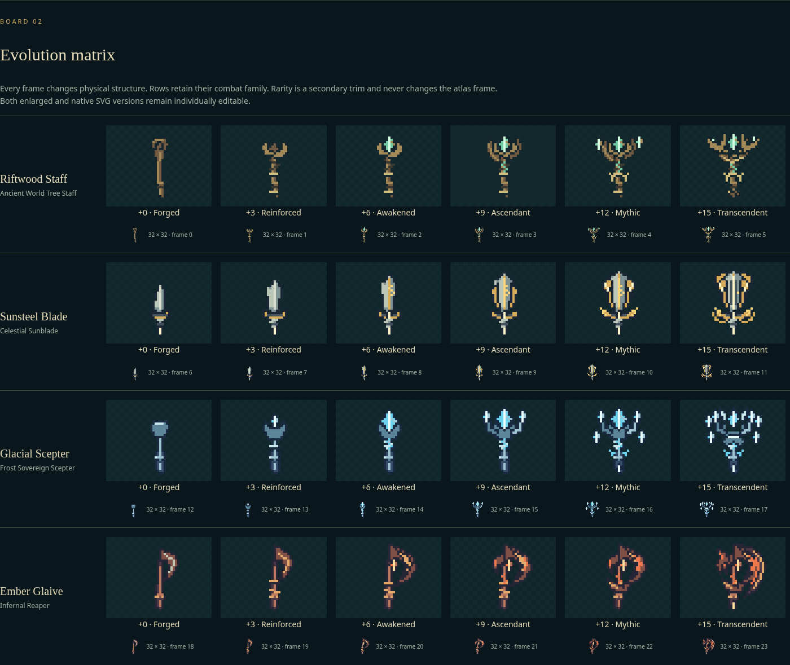

# Weapon visual evolution

The equipped item physically changes at **+3, +6, +9, +12 and +15**. All four
existing families have six original silhouettes. `EquipmentInstance.enhancement`
is the only progression value: `clamp(floor(enhancement / 3), 0, 5)`. Rarity remains
an independent trim/ring color. Item level, class, temporary blessings and mode
do not select the appearance.

## Repository and design audit

The workspace initially contained `8969177` on clean branch `work`. Refreshing
GitHub revealed that `main` had advanced to `b5f09e7` (cinematic landing, layered
pixel art and unified progression). That current architecture was merged into
`codex/weapon-visual-evolution` before final integration and validation. The live
branch has 48px modular character layers, 26 pose columns, 32px held weapons,
18 legacy weapon/tool frames, a central asset registry and immutable snapshots.
The existing rarity-offset `weaponVisualFrame()` now delegates to the canonical
evolution resolver. Body/equipment layer construction, action receipts, tools,
cinematic landing, progression and combat animation tracks are preserved.
Preloading remains registry-backed through `asset-preloader.ts`; the new atlas is
registered in `assets.ts` and the generated `asset-index.ts` as common weapon art.

Figma capability discovery found no callable Figma MCP tools. Plugin discovery
reported Figma available but not installed. No Figma file was created, no design
context was read from Figma, and there is no Figma URL. The authorized fallback is
[five editable HTML/SVG review boards](design/weapon-evolution.html), generated
from production frames, real enhancement quotes and character hand anchors.
They cover art direction, all 24 forms at native/enlarged scale, upgrade outcomes,
inventory, and all character/family combinations with direction/pose/mobile
controls. They are a local specification, not a flattened Figma design.

## Asset pipeline

```sh
# Only regeneration requires Python + Pillow; play/build/test need neither.
python scripts/generate-weapon-evolution.py
python scripts/generate-weapon-evolution.py --check
npx tsx scripts/generate-weapon-design.ts
```

The existing `npm run assets:generate` pipeline also invokes the weapon generator;
run `npm run assets:index` after changing any art. No dependency or lockfile
changes are required.

- Runtime: `public/assets/characters/weapon-evolution.png`, **192 × 128 RGBA**.
- Metadata: adjacent `weapon-evolution.json`, including frame bounds, palettes,
  SHA-256 pixel hashes and the stable **(16,24)** grip.
- Pixel-editable source: generator and 24 integer-rectangle SVG files in
  `art/weapon-evolution/`. Edit the generator to keep regeneration deterministic.
- Rows: staff, sword, scepter, glaive. Columns: Forged, Reinforced, Awakened,
  Ascendant, Mythic, Transcendent. Frame = `familyRow * 6 + tier`.
- Every frame has a clear one-pixel perimeter, binary alpha, no antialiased edges,
  and an independent silhouette. Outlines and highlights are placed on the final
  32px grid. CSS/Phaser use nearest-neighbor sampling; Phaser retains pixelArt,
  roundPixels, disabled antialiasing and the existing root scale for 48px anatomy and 32px held equipment.
- Source art and atlas are original CC0. Reference images informed progression
  and silhouette principles; their pixel arrangements were not copied.
- The legacy eighteen-frame `weapons.png` is preserved unchanged, including practice
  daggers, fire and all three gathering/crafting tool visuals.

Serve the repository root (for example with `python -m http.server 3200`) and open
`/docs/design/weapon-evolution.html` to review the editable boards. No game route,
runtime dependency, external image service or new database is needed.

## One presentation contract

`src/game/presentation/weapon-visual.ts` owns the tier, family/frame, rarity accent,
family effect color, next milestone, safe asset fallback and effect budget.
`resolveWeaponVisual()` accepts the actual instance or a run snapshot. For a
snapshot it uses its historical embedded instance. It never looks up today's
equipped inventory or writes a second progression field.

Phaser's shared `CharacterRig` (town, training and campaign/farming combat) and
React's `WeaponSprite` (character previews, inventory/equipment/overflow, save
profile, shop preview, Sanctuary, enhancement comparisons and combat HUD) consume
that contract. Inventory-backed paths pass the exact item; shop prototypes are
explicit base previews. The rig updates textures immediately on item replacement
and retains its original hand anchors, facing, depth and attack rotations. A shared
22.5° idle cant keeps ornate crowns clear of the face, with mirrored left/up poses.

If the evolution texture/frame is absent, the family-correct legacy weapon is
used. React marks it with a dashed outline and a localized fallback title;
Phaser retains its existing localized missing-art notice and exposes fallback
status in its test description. If neither texture/frame is available the held
layer is hidden; React shows a missing-art marker. No unrelated family is used.

Snapshot `schema: 1`, legacy `assetKey`, base frame and validation remain intact.
No save migration/reset or changes to ownership, probabilities, costs, pity,
downgrades, hitboxes, damage, intervals or attack behavior are introduced.
Checkpoint restoration derives the appearance from the immutable historical
instance. A downgrade below a milestone immediately returns to the lower form.

## Interaction and effects

The existing enhancement quote and confirmation remain authoritative. The detail
panel adds current/next forms, tier names, milestone distance, a highlighted next
success when applicable, and an explicitly locked future-appearance collection.
All new text uses the existing English/Thai localization system.

Only a **committed successful** enhancement crossing a tier boundary opens the
2.4-second forging reveal: old form, stepped pulse, new form and tier label. It
can be skipped with Continue, close or Escape. Failures and downgrades retain the
existing real result/history and never trigger the celebration. Storage failure
cannot show an unsaved evolution.

Ambient VFX are decorative: T0 none, T1 material polish, T2 glint, T3 pulse,
T4 two pixels, T5 three pixels plus a short attack arc. Low quality removes
particles/trails and the pulse; reduced effects or OS reduced motion removes
decorative animation. No React frame-loop state is introduced. The PWA cache
version is bumped and the new atlas is warmed with existing original assets.

## Validation

Unit tests decode the actual committed PNG, verify alpha/gutters/anchors/palettes,
compare per-frame hashes, and require six distinct alpha silhouettes per family.
They exercise every +0–15 rank, invalid values, independent rarity/item level,
real successful enhancement commands through +15, failure/downgrade behavior,
historical snapshots/checkpoints, fallback/practice art and quality/motion limits.

Browser tests compare all 24 React HUD and Phaser frames, inspect real texture
loads/fallbacks, exercise all three classes and four attacks/worlds, enhance an
equipped +5 weapon to +6, reload it, reject failure celebrations, check downgrade
appearance, and inspect Thai/mobile previews. Existing checkpoint/town/live equip
and PWA tests cover the surrounding flow.

Validated on 2026-11-13 against the merged current architecture:

| Check | Result |
| --- | --- |
| `npm run typecheck` | Passed, including the final production prebuild |
| `npm run lint` | Passed |
| `npm run format:check` | Passed, including both new React components |
| `npm test` | **366 passed** across 21 files, including 39 evolution checks |
| `npm run assets:check` | Passed: all 355 registered PNGs and item/frame references |
| `python scripts/generate-weapon-evolution.py --check` | Passed: deterministic PNG, metadata and all SVG sources |
| `NEXT_PUBLIC_E2E=1 npm run build` + `NOWRIFT_E2E=1 npm run test:browser` | **112 browser tests passed** on the merged architecture |
| Final ordinary `npm run build` | Passed; the workspace retains the build without test fixtures |
| Ordinary-build equipment/RPG Playwright suite | **22 passed**, including all five saved milestone reveals, quote deductions, skip, reload, failure and downgrade |
| `npm run test:playthrough` | Victory at 527.85 simulated seconds, 911 kills |
| `npm run test:stress` | Passed: 3,600 frames / 180 enemies; Node simulation only |

Five instrumentation-only checks are intentionally skipped in the ordinary-build
run; they passed in the full instrumented suite. The full browser suite also
covered Story/campaign worlds, Free Mode gathering/extraction, all three classes,
inventory replacement without a canvas remount, historical checkpoints, denied
storage, offline PWA relaunch, Thai text, narrow/landscape layouts, tools, reduced
effects and CPU-throttled rendering. No unresolved check failures remain.

The complete suite ran before final small hardening changes (the committed-action
receipt gate, explicit low-quality rig input and missing-both-textures label).
The final production build, all unit checks, and the ordinary equipment/RPG
browser run then passed with those changes. The latter explicitly exercises
every milestone at +3, +6, +9, +12 and +15 with actual repository transactions.

## Review images



- [Enhancement before +6](images/weapon-evolution/evolution-before.png) ·
  [after the committed +6 enhancement](images/weapon-evolution/evolution-after.png)
- [Gameplay +0](images/weapon-evolution/sunsteel-before.png) ·
  [gameplay +15](images/weapon-evolution/sunsteel-after.png)
- [Thai mobile comparison](images/weapon-evolution/mobile-th.png) ·
  [all twelve character/family combinations](images/weapon-evolution/character-rigs.png)

All review captures are local, seeded game scenarios. No player data or external
images are embedded. The editable design boards remain available separately.
